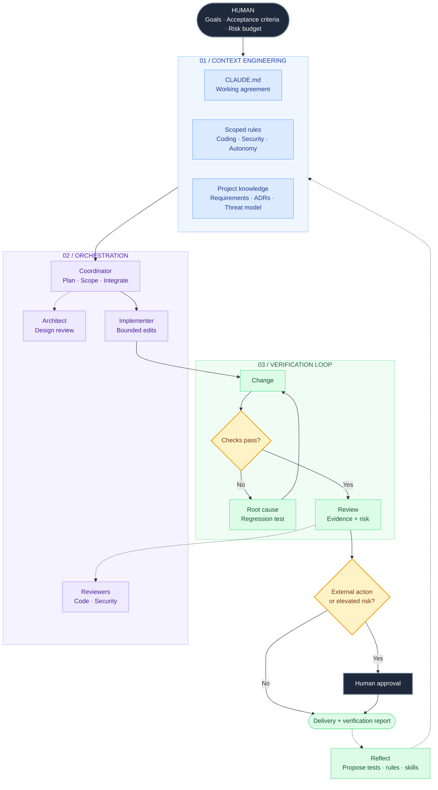
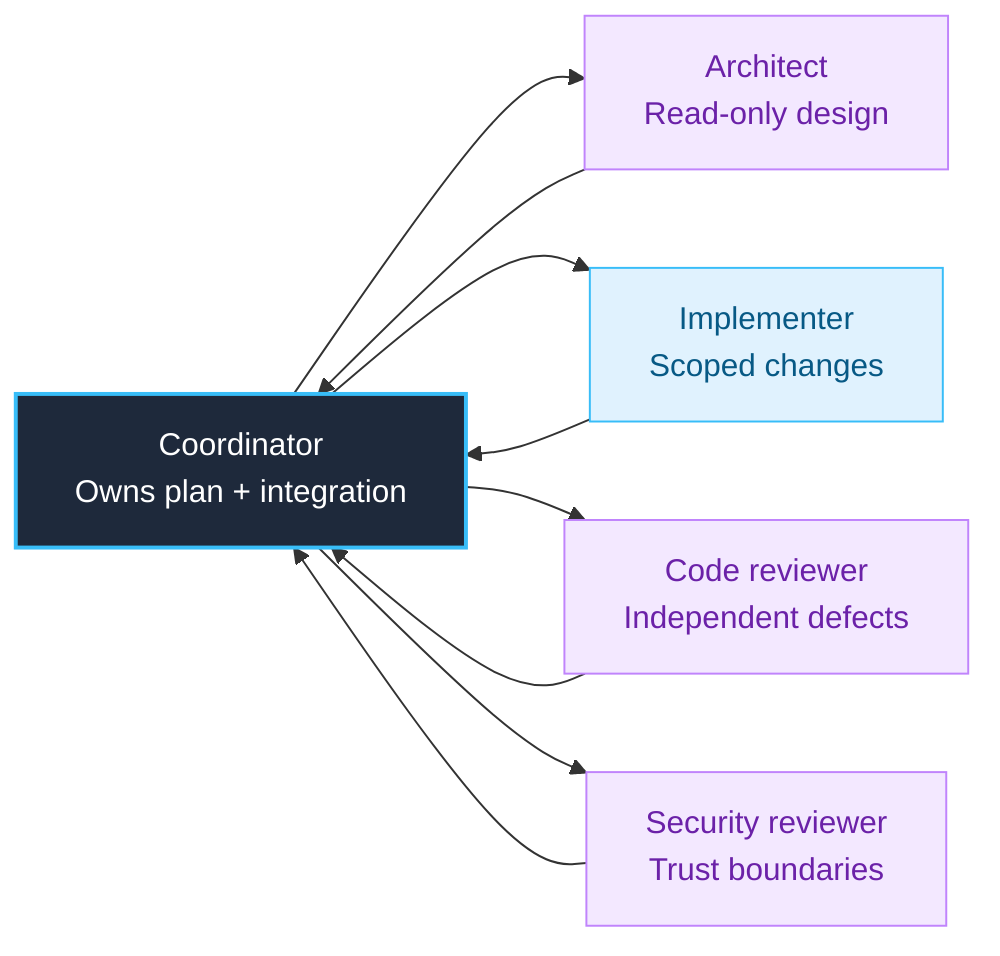
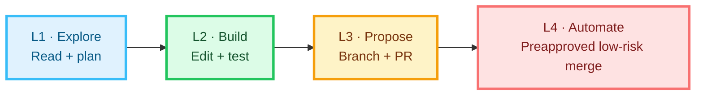
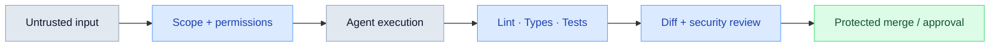

# Claude Engineering Template

### Context-aware · Verification-first · Guardrail-driven

**A reusable engineering foundation for Claude Code and agentic software development.**

[](https://github.com/d01ki/Claude-Engineering-Template/actions/workflows/template-validation.yml)
[](https://github.com/d01ki/Claude-Engineering-Template/actions/workflows/security-checks.yml)

**[Architecture](#-architecture) · [Features](#-capabilities) · [Quick start](#-quick-start) · [Existing projects](#-adopting-in-an-existing-project) · [Safety](#-security--limitations)**

---

## Philosophy

> **Autonomy is earned through verification, not granted through prompts.**

This template structures the development loop around **clear context → bounded execution → deterministic checks → evidence-based review → reusable learning**.

It is a **stack-agnostic starter**, not an executable application, official Anthropic template, certification material, or guarantee of security. Its architecture is inspired by general context engineering and verification-first agent development practices.

## Architecture



**Key principle:** The coordinator owns integration and final verification. Specialist agents are optional, scoped, and never a substitute for real tests or human approval.

## Capabilities

| Layer | Included | Why it exists |
| :-- | :-- | :-- |
| **Context** | `CLAUDE.md`, `context-management.md` | Load only task-relevant knowledge |
| **Policies** | Coding, security, testing, autonomy rules | Explicit constraints and escalation points |
| **Agents** | Architect, implementer, code reviewer, security reviewer | Bounded delegation and independent review |
| **Skills** | Implement, review, verify, root cause, reflect, release | Repeatable workflows without always-on context |
| **Knowledge** | Requirements, architecture, threat model, ADRs, plans | Decisions and evidence survive chat sessions |
| **Guardrails** | Permission configuration, approval policy, CI baseline | Defense in depth, not prompt-only security |
| **Feedback** | Verification → correction → reflection | Turn confirmed failures into preventive controls |

### Agent responsibilities



**Avoid unnecessary parallelism.** Delegate only when a task has clear boundaries and an independent review or isolated context is valuable.

### Available skills

| Skill | Purpose |
| :-- | :-- |
| `/implement-feature` | Plan and implement a tested feature |
| `/review-pr` | Evidence-based review of an actual diff |
| `/verify-change` | Run available checks and report exact outcomes |
| `/root-cause-analysis` | Investigate defects and add regression prevention |
| `/reflect` | Propose reusable lessons from verified work |
| `/release` | Release-readiness checklist; **no automatic deployment** |

Skill discovery and invocation depend on your installed Claude Code version. All bundled skills are designed for explicit invocation.

## Autonomy & guardrails

**Default: L2.** Agents may make scoped local edits and run safe checks, but external actions require approval.



| Level | Permitted scope | Human checkpoint |
| :-- | :-- | :-- |
| **L1** | Research and planning | Before editing |
| **L2 · Default** | Scoped edits and safe local checks | Before push or external side effects |
| **L3** | Branch and PR creation **when authorized** | Before merge |
| **L4** | Narrow auto-merge of preapproved low-risk changes | Requires a separate policy, protected branches, required checks, audit and rollback |



**Guardrails are layered:** prompt guidance + scoped tools + sandboxing + tests + CI + branch protection + human review. Neither `CLAUDE.md` nor a passing CI badge proves security.

## Quick start

1. Enable **Template repository** in GitHub **Settings → General**, then select **Use this template → Create a new repository**.
2. Clone your new repository and launch Claude Code from its root.
3. Fill in `docs/requirements.md`, `docs/architecture.md`, and `docs/threat-model.md` based on the actual project.
4. Choose a stack, add real code/tests, and replace the placeholder verification commands in `CLAUDE.md`.
5. Extend CI with project-specific formatting, lint, type checks, tests, dependency audits and security scans.
6. Review permissions and MCP configuration before enabling integrations.

**Suggested first prompt:**

```text
Read CLAUDE.md and the requirements, architecture and threat model.
Inspect the existing code before making changes.
Propose a minimal plan with acceptance criteria, trust boundaries,
verification commands and unresolved assumptions.
Do not deploy, push or merge without explicit approval.
```

## Adopting in an existing project

**Do not copy this repository over an existing codebase.** Adapt the policies to the current stack and preserve existing application code, tests and CI.

1. Inspect the existing `CLAUDE.md`, `.claude/`, test tooling and workflows.
2. Merge relevant rules, skills and agents without overwriting project-specific configuration.
3. Derive architecture and threat-model documentation from **actual implementation**, not assumptions.
4. Add verified commands to `CLAUDE.md` and integrate checks into the existing CI.
5. Introduce the changes in a separate branch and review the diff.

## Repository structure

```text
.
├── CLAUDE.md
├── .claude/
│   ├── settings.json
│   ├── rules/
│   │   ├── coding.md
│   │   ├── security.md
│   │   ├── testing.md
│   │   ├── autonomy.md
│   │   └── context-management.md
│   ├── agents/
│   │   ├── architect.md
│   │   ├── implementer.md
│   │   ├── code-reviewer.md
│   │   └── security-reviewer.md
│   ├── skills/
│   │   ├── implement-feature/
│   │   ├── review-pr/
│   │   ├── verify-change/
│   │   ├── root-cause-analysis/
│   │   ├── reflect/
│   │   └── release/
│   └── hooks/
│       └── README.md
├── docs/
│   ├── requirements.md
│   ├── architecture.md
│   ├── threat-model.md
│   ├── decisions/
│   ├── plans/
│   └── agent-engineering/
│       ├── orchestration.md
│       ├── autonomy-levels.md
│       ├── guardrails.md
│       └── lessons-learned.md
├── .github/workflows/
│   ├── template-validation.yml
│   └── security-checks.yml
├── src/
├── tests/
├── scripts/
├── .mcp.json
├── .env.example
├── .gitignore
├── .editorconfig
├── CONTRIBUTING.md
└── SECURITY.md
```

## Security & limitations

- `.claude/settings.json` provides conservative permission settings, **not an isolation boundary**. Use least-privilege credentials and sandboxing.
- `.mcp.json` is intentionally empty; no external MCP servers are enabled.
- `.claude/hooks/` contains guidance only; **no executable hooks are enabled**.
- `template-validation.yml` checks template structure and JSON syntax.
- `security-checks.yml` checks **tracked sensitive filenames only**; it does **not** inspect file contents for secrets.
- Neither workflow tests application logic. Add real tests, scanning and required branch protection for production.
- No automatic merging, deployment, secret access or cloud spending is configured.

## Design references

- [Claude Code overview](https://code.claude.com/docs/en/overview)
- [Claude Code settings](https://code.claude.com/docs/en/settings)
- [Claude Code memory and rules](https://code.claude.com/docs/en/memory)
- [Claude Code skills](https://code.claude.com/docs/en/skills)
- [Claude Code subagents](https://code.claude.com/docs/en/sub-agents)
- [Lauren Tan / Cursor pstack](https://github.com/cursor/plugins/blob/main/pstack/README.md)
- [Agent workflows discussion on note](https://note.com/yasuhitoo/n/n181c64973748)
- [AI Setouchi: agent guardrails](https://ai-setouchi.com/articles/lauren-tan-agent-guardrails)
- [BigGo discussion](https://finance.biggo.jp/news/e075716ae1e521f9)

The ideas here are original, Claude Code-oriented adaptations of broader agent engineering practices, not a reproduction or endorsement by those authors. The latter two articles were not independently retrievable during the v2 update; this README does not attribute specific technical claims to them.

## Contributing

See [CONTRIBUTING.md](CONTRIBUTING.md) and [SECURITY.md](SECURITY.md). A license has not yet been selected; choose one before encouraging unrestricted reuse.

