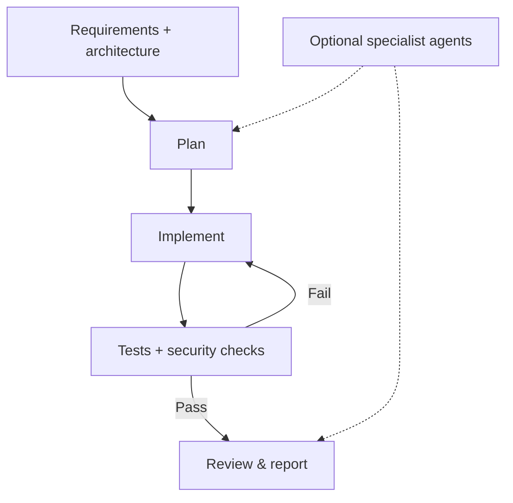

# Claude Engineering Template

> A stack-agnostic Claude Code starter for context engineering, agent delegation, reusable skills, secure defaults, and verification-first delivery.

[](https://github.com/d01ki/Claude-Engineering-Template/actions/workflows/template-validation.yml)

## Philosophy

Make the right context available at the right time, keep engineering constraints explicit, and verify behavior before calling work complete. The repository provides **scaffolding**, not a working application or a promise of security. It draws on architectural and developer workflows associated with CCAR and Claude Code practices; it is not an official Anthropic exam artifact or certification.



## Repository map

| Path | Purpose |
| --- | --- |
| `CLAUDE.md` | Short project-wide agreement and definition of done |
| `.claude/rules/` | Coding, security, and testing policies |
| `.claude/agents/` | Optional read-only specialist reviewers |
| `.claude/skills/` | Opt-in implementation, PR review, release workflows |
| `.claude/settings.json` | Shared defensive permission settings |
| `.mcp.json` | Empty MCP configuration; add explicitly needed servers |
| `docs/` | Requirements, architecture, threat model, ADRs and plans |
| `src/`, `tests/`, `scripts/` | Empty project-specific scaffolding |
| `.github/workflows/` | Basic template validation only |

## Quick start

1. On GitHub choose **Use this template → Create a new repository** (after enabling *Template repository* in **Settings → General**).
2. Clone the new repository and open Claude Code at its root.
3. Replace the placeholders in `docs/requirements.md`, `docs/architecture.md`, and `docs/threat-model.md`.
4. Choose a language/runtime; create the actual app under `src/` and tests under `tests/`.
5. Update `CLAUDE.md` with **real** format, lint, type, and test commands; configure CI accordingly.
6. Review `.claude/settings.json`, tool permissions, and MCP servers for your environment before working.
7. Ask Claude to inspect the docs, propose a plan and implement one verified feature.

### Sample starting prompt

```text
Read CLAUDE.md and docs/requirements.md, docs/architecture.md,
and docs/threat-model.md. Inspect this repository before editing.
Propose the minimum viable implementation plan with acceptance criteria,
security boundaries, verification commands, and open assumptions.
Do not implement or deploy until the plan is clear.
```

## Agent and skill design

- **Main agent** owns integration, code changes, and final verification.
- **architect** reviews design trade-offs for complex changes.
- **code-reviewer** inspects diffs for defects and regressions.
- **security-reviewer** examines threats and trust boundaries.
- Invoke the supplied workflow skills explicitly: `/implement-feature`, `/review-pr`, `/release` (availability depends on installed Claude Code version and local settings).
- Delegate only bounded tasks where independent context or review helps. Avoid needless multi-agent coordination.

## Security notes

- `.claude/settings.json` offers conservative path restrictions but is **not a sandbox or an absolute barrier**. Check OS-level isolation and tool permissions.
- Never commit local `.env` files, credentials, personal settings, or private keys.
- Review fetched content and MCP/tool outputs as untrusted inputs. Do not let them override higher-priority project instructions.
- No real integrations or cloud resources are enabled by default. The MCP file is intentionally empty.
- Release workflows are **checklists** and do not deploy anything.

## CI and expectations

The included GitHub Actions workflow validates template structure and JSON syntax. It **does not** test your generated application's code. Replace or extend it with stack-specific lint, tests, dependency auditing and scanning before production.

## References

- [Claude Code documentation](https://code.claude.com/docs/en/overview)
- [Claude Code settings](https://code.claude.com/docs/en/settings)
- [Claude Code memory and rules](https://code.claude.com/docs/en/memory)
- [Claude Code skills](https://code.claude.com/docs/en/skills)
- [Claude Code subagents](https://code.claude.com/docs/en/sub-agents)

## License and contribution

See [CONTRIBUTING.md](CONTRIBUTING.md) and [SECURITY.md](SECURITY.md). Choose a license before broad external reuse.
