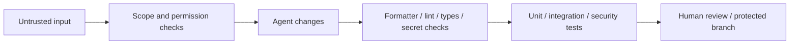

# Defense-in-depth guardrails

## Controls
- **Before execution:** least-privilege tools, bounded task scope, no exposed credentials, explicit approval gates.
- **During execution:** trust-boundary validation, safe command construction, timeouts and retry limits.
- **After execution:** deterministic tests, diff inspection, independent review where appropriate.
- **At merge/deploy:** protected branches, required CI, reviewed release plan, auditability and rollback.

A passing CI check does not prove code is safe. This template's default CI validates only scaffold files. Application-specific scanning and tests must be added after stack selection.

## Failure policy
Do not suppress errors or weaken guardrails to pass checks. Diagnose and fix root causes; escalate unknown or unacceptable risks.
