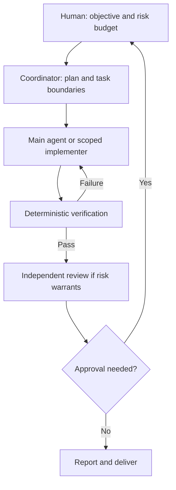

# Agent orchestration

## Recommended workflow

## Delegation contract
Each task must specify: objective, acceptance criteria, input files, allowed edit paths, dependencies, required checks, expected output and escalation triggers.

Delegate independent research or reviews first. Parallel editing is appropriate only with non-overlapping file ownership and a coordinator responsible for integration. Avoid agent loops without explicit retry budgets. Summaries from workers are not evidence; the coordinator verifies integrated results.

## Reliability
Bound retries and time/cost. Escalate conflicting results, uncertainty, security-sensitive side effects and failures that require weakening controls. Use tool permissions, CI and human approvals for actual enforcement.
