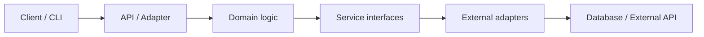

# Architecture

## Overview
Document actual architecture here; the diagram is illustrative only.

## Components and responsibilities
| Component | Responsibility | Dependencies |
| --- | --- | --- |
| API / Adapter | Input/output, transport | Domain |
| Domain | Business rules | Interfaces |
| Infrastructure | Storage, network, integrations | External systems |

## Trust boundaries
TODO: Distinguish user-facing, service, tool, and infrastructure boundaries.

## Data flows and failure modes
TODO: Inputs, outputs, sensitive data, retries, timeouts, recovery.

## Deployment and operations
TODO: Hosting, secrets, telemetry, backup, rollback, SLOs.

## Open questions
- TODO
