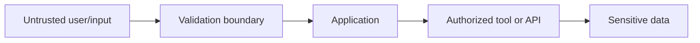

# Threat Model

## Scope, assumptions, and assets
TODO: Protected data, systems, models, infrastructure and threat actors.

## Data-flow / trust-boundary map

## Threat inventory (STRIDE)
| Category | Example concern | Mitigation | Validation |
| --- | --- | --- | --- |
| Spoofing | Impersonated identity | Authentication | Auth tests |
| Tampering | Untrusted payload manipulation | Input validation, signatures | Negative tests |
| Repudiation | Missing audit trail | Protected audit logs | Logging review |
| Information disclosure | Secret leakage | Least privilege, redaction | Secret scan |
| Denial of service | Resource exhaustion | Quotas, timeouts | Load tests |
| Elevation of privilege | Missing authorization | Server-side authorization | Access tests |

## AI / agent-specific risks
- Prompt injection via retrieval or tool output
- Confused deputy / over-privileged tools
- Unvalidated model-generated code or commands
- Sensitive context disclosure across boundaries
- Excessive autonomous tool calls, cost, or side effects

## Residual risks and review triggers
TODO: Owners, risk acceptance, and changes requiring reassessment.
